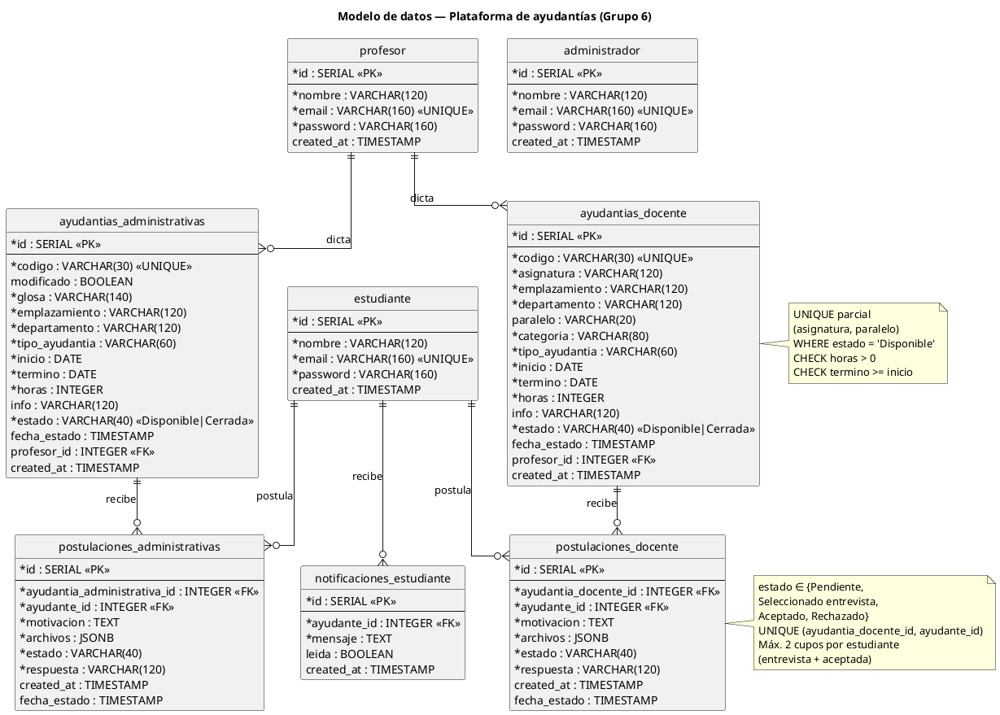

# Textos para copiar y pegar — Hito 3

## 1. Explicación textual debajo del diagrama de arquitectura

### Responsabilidad de los componentes

La arquitectura separa la interacción de usuario, la lógica de negocio y la persistencia en capas claras que colaboran por HTTP/JSON.

- **Frontend (HTML5, CSS3, JavaScript y Bootstrap):** renderiza las vistas de estudiante, profesor y administrador; captura formularios y archivos; muestra estados de postulación, listados y notificaciones. No aplica reglas de negocio críticas por sí solo: delega validaciones al backend.
- **Backend Node.js + Express:** expone la API REST, autentica por rol mediante cookies de sesión firmadas, valida transiciones de estado, aplica el tope de ayudantías, gestiona subida de archivos (Multer) y dispara notificaciones por correo (Nodemailer/Brevo). También sirve las páginas HTML protegidas.
- **Base de datos PostgreSQL (Neon en despliegue):** almacena usuarios, ayudantías docentes/administrativas, postulaciones, archivos metadatos y notificaciones. Las claves foráneas, índices únicos y restricciones CHECK evitan inconsistencias (estados inválidos, postulaciones duplicadas, ramos abiertos repetidos, máximo de cupos).
- **Servicio de correo:** notifica entrevista, aceptación y cierre de postulaciones, alineado con los cambios de estado del backend.
- **Contenedores / hosting (Docker o Railway + Neon):** empaquetan y conectan la aplicación con la base de datos para el despliegue del prototipo.

### Colaboración en los recorridos del MVP

1. **Administrador → sistema:** crea o elimina ayudantías y asigna cada ramo a un profesor.
2. **Estudiante → sistema:** consulta ayudantías disponibles, postula con motivación y documentos, y consulta el estado de sus postulaciones.
3. **Profesor → sistema:** ve solo sus ramos, lista postulantes, cambia estados (entrevista / aceptación / rechazo) y cierra el proceso de un ramo.
4. **Sistema → estudiante:** registra el nuevo estado, guarda notificación in-app y envía el correo correspondiente.
5. **Cierre de ramo:** el sistema confirma a aceptados, informa a no seleccionados y deja de aceptar nuevas postulaciones.

Estos recorridos cubren el flujo mínimo viable: crear/asignar, postular, seleccionar y notificar, sin incluir pagos ni integración SIGA/API universitaria.

### Cómo soporta el trabajo en dos iteraciones

- **Iteración 1 (base del MVP):** autenticación por rol, registro/postulación con adjuntos, listado de ayudantías disponibles y envío de correos al cambiar la selección (requisitos orientados a entrada de datos y notificación temprana).
- **Iteración 2 (consolidación del flujo completo):** cambio controlado de estados, listado de postulantes por ramo, persistencia e integridad referencial, interfaz adaptable, tope de dos ayudantías en entrevista o aceptadas, y cierre de postulaciones con notificaciones diferenciadas.

La separación frontend/API/BD permite repartir el trabajo por capa e iteración: en I1 se estabilizan formularios y persistencia básica; en I2 se refuerzan reglas de negocio, seguridad de rutas y calidad (responsive, restricciones). Queda fuera del alcance implementable la obtención automática de datos desde SIGA (RS7), reemplazada por carga manual de ramos.

---

## 2. PlantUML — modelo de datos (pegar en https://editor.plantuml.com/)

---

## 3. Informe retrospectivo del proyecto

### Informe retrospectivo — Grupo 6 (New PAU Tech)

A lo largo del proyecto el equipo logró construir un prototipo usable del flujo completo de ayudantías: registro e inicio de sesión por rol, postulación con documentos, selección por parte del profesor, notificaciones por correo y gestión administrativa de ramos. Esa continuidad entre hitos —pasar de requisitos en tablero a un producto desplegado— es la principal fortaleza: hubo un MVP concreto que se puede demostrar, con base de datos persistente y roles diferenciados.

Otra fortaleza fue la capacidad de reaccionar a la retroalimentación de QA y de la contraparte académica. Varias observaciones (estados inconsistentes, postulaciones duplicadas, tope de ayudantías, falta de protección al navegar a `/admin` o `/profesor`) se tradujeron en reglas explícitas en backend: restricciones CHECK, índices únicos, cookies de sesión firmadas y validación de usuario en base de datos antes de servir páginas o ejecutar APIs. También se avanzó en despliegue (Neon/Railway) y en detalles de experiencia (header unificado, responsive), lo que muestra aprendizaje técnico acumulado entre iteraciones.

Las fallas más visibles estuvieron en la calidad temprana de las reglas de negocio y en la documentación de diseño. En las primeras versiones era posible crear combinaciones de estado incoherentes, postular más de una vez al mismo ramo o acceder a vistas de rol solo cambiando la URL, porque la seguridad vivía demasiado en el frontend y la base no imponía invariantes. Eso ocurrió, en buena medida, por priorizar “que se vea el flujo” en la Iteración 1 sin cerrar al mismo tiempo las restricciones de integridad y autorización; el costo apareció en la revisión del Hito 3.

También faltó profundidad en el documento de diseño: el diagrama de arquitectura y el modelo de datos no se acompañaron a tiempo con explicación textual de responsabilidades, recorridos del MVP, soporte a las dos iteraciones y tipos de dato por atributo. Esa omisión no bloqueó el código, pero sí la evaluación, porque el diseño no comunicaba por sí solo cómo se repartía el trabajo ni qué quedaba fuera de alcance (en particular RS7 / SIGA, que no era implementable sin API universitaria).

En síntesis, el equipo fue fuerte construyendo e iterando sobre un prototipo real, y más débil al adelantar controles de integridad/seguridad y al documentar el diseño con el mismo rigor que el software. La lección es explícita para cierres futuros: cada historia del MVP debería nacer con su regla en base de datos, su guardia de rol en servidor y su párrafo de diseño asociado, en lugar de corregirlos solo después de la pauta de QA.
